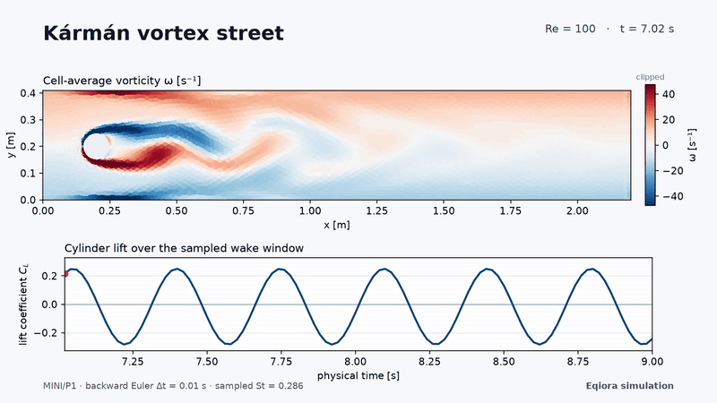

<p align="center">
  <a href="https://eqiora.org"></a>
</p>

<h1 align="center">Eqiora</h1>

<p align="center">
  <strong>Open-source computational physics.</strong><br>
  Write the equations as you would on paper, couple physics by region, choose how to solve them, and differentiate the results.<br>
  A Python interface on a Rust core.
</p>

<p align="center">
  <a href="https://pypi.org/project/eqiora/"></a>
  <a href="https://docs.rs/eqiora/0.1.5/eqiora/"></a>
  <a href="https://github.com/nkiyohara/eqiora/releases"></a>
  <a href="https://pypi.org/project/eqiora/"></a>
  <a href="docs/rust-api.md"></a>
</p>

<p align="center">
  <a href="https://github.com/nkiyohara/eqiora/actions/workflows/ci.yml"></a>
  <a href="https://github.com/nkiyohara/eqiora/actions/workflows/pages.yml"></a>
  <a href="https://eqiora.org"></a>
  <a href="https://eqiora.org/release-notes/"></a>
  <a href="LICENSE"></a>
</p>

<p align="center">
  <a href="#-get-started-with-uv"><strong>Get started</strong></a> ·
  <a href="https://eqiora.org/learn/"><strong>Learn the physics</strong></a> ·
  <a href="https://eqiora.org/gallery/"><strong>Explore simulations</strong></a> ·
  <a href="https://eqiora.org/reference/standard-packages/">Standard library</a> ·
  <a href="https://eqiora.org/reference/">API reference</a> ·
  <a href="docs/roadmap.md">Roadmap</a> ·
  <a href="CONTRIBUTING.md">Contribute</a>
</p>

---

## See the physics

**A Kármán vortex street behind a circular cylinder.** This transient
Navier–Stokes example builds the channel geometry, runs the flow until the wake
develops, and plots cell-average vorticity from Python. The animation shows the
alternating vortices moving downstream, with the lift history underneath.

[](https://eqiora.org/gallery/karman-vortex-street/)

[Watch the MP4](docs/site/src/assets/gallery/karman-vortex-street.mp4) ·
[Explore the model and run it yourself](https://eqiora.org/gallery/karman-vortex-street/)

| Explore | Inside the walkthrough |
| --- | --- |
| [Kármán vortex street](https://eqiora.org/gallery/karman-vortex-street/) | Transient incompressible flow, vorticity, cylinder force, and pressure observations. |
| [Steady flow past a cylinder](https://eqiora.org/gallery/exact-cylinder-steady-stokes/) | Channel geometry, Gmsh meshing, steady Stokes flow, and the pressure field. |
| [Linear elasticity](https://eqiora.org/gallery/mixed-boundary-elasticity/) | A square fixed on one edge, mixed boundary conditions, and its displacement. |

## What a model looks like

A model is a set of equations with units. This one is exponential decay,
`dx/dt + k x = 0`:

```eqiora
model decay() {
  state x: 1;
  initial { x = 1; }
  parameter rate: 1 / s = 1;
  relation flow { derivative(x) + rate * x = 0; }
}
```

From Python you compile it, choose a time integrator, and run it:

```python
import eqiora

model = eqiora.compile(path="decay.eqi")
x = model.field("x")
plan = eqiora.resolve(
    model,
    temporal=eqiora.time.Tsitouras45(
        initial_step_s=0.01,
        relative_tolerance=1e-9,
        absolute_tolerances={(x, 0, 0, False): 1e-11},
    ),
)
result = eqiora.run(plan, state=eqiora.State.initial(plan), until_s=1.0, output_times_s=(1.0,))
print(result.series(x).values.numpy())  # [0.36787944], which is exp(-1)
```

## What Eqiora does

You write a physical system as equations, in the `.eqi` language or from
Python: quantities with units, fields, boundary conditions, connected
components, continuous dynamics, and discrete events. Common equations and
boundary conditions come from the
[standard library](https://eqiora.org/reference/standard-packages/), and you
can mix them with your own. The compiler checks names, types, and physical
dimensions, so adding a length to a velocity fails before anything runs.

Multiphysics is written the same way. Each equation is written on the region
where it holds, and regions are joined where they meet:

```eqiora
relation fluid_momentum on fluid { ... }
relation solid_momentum on solid { ... }
connect fluid_interface, solid_interface;
```

Eqiora assembles one coupled system and solves it together. The
[fluid–structure example](examples/fixed-reference-fsi.eqi) is written this
way.

The numerical method is a separate choice. The same model can be solved with
finite elements or finite volumes and with different solvers, on CPU threads,
and for selected problems with MPI or CUDA. Results can be differentiated with
respect to model parameters, and the derivatives work with JAX and PyTorch.

From Python you build geometry, generate meshes, run simulations, and get
fields as NumPy arrays. Each result records the equations, geometry, mesh, and
solver settings that produced it. Python and Rust share the same compiled model
and execution core. The [capability matrix](docs/capability-matrix.md) lists
exactly which combinations work today.

## Get started with uv

Add the published Python package to your project:

```console
uv add eqiora
```

Prebuilt wheels support Linux x86-64 and ordinary-GIL CPython 3.11–3.14.
Follow [Get started](https://eqiora.org/get-started/) to create a project with
[uv](https://docs.astral.sh/uv/getting-started/installation/), save a small decay
model, and run it. The first model works with the published package; no Rust
compiler or source checkout is needed.

Then pick a subject in [Learn](https://eqiora.org/learn/): mathematical
modeling, heat transfer, numerical simulation, fluid flow, solid mechanics,
circuits and dynamics, or inverse problems. Each one derives the mathematics,
runs the model, and then shows how standard components shorten it.

To start with steady flow around a cylinder, open the
[step-by-step walkthrough](https://eqiora.org/gallery/exact-cylinder-steady-stokes/)
and its [complete Python script](examples/python/exact_cylinder_stokes.py).

## From a model to a result

A **Model** holds the mathematics. Resolving it with a mesh, method, and solver
gives a **Plan**, which records those numerical choices. Running the Plan gives
a **Result** with the outputs and diagnostics.

```text
Equations + Geometry   →   Model   →   Plan   →   Result
                          compile     resolve    run
                                      ↑
                              Mesh · Method · Solver
```

You can therefore try different discretizations and solvers without editing the
model, and every field in a Result can be traced back to the choices that
produced it. The [architecture overview](docs/architecture.md) explains how the
pieces fit together.

## Use from Rust

Add the published facade to a Cargo project:

```console
cargo add eqiora@=0.1.5
```

Start with the [Rust guide](docs/rust-api.md) for model compilation and optional
backends, or browse the [API docs](https://docs.rs/eqiora/0.1.5/eqiora/).

## More ways to work

| Interface | Use it to |
| --- | --- |
| **Python** | Write, compile, mesh, solve, and plot. This is the main interface. [Reference →](https://eqiora.org/reference/python/) |
| **Rust** | Embed Eqiora in a Rust application through the `eqiora` crate. [Guide →](docs/rust-api.md) |
| **CLI** | Check a local `.eqi` file with `eqiora check`. [Command reference →](https://eqiora.org/reference/cli/) |
| **Editor support (preview)** | Get diagnostics, formatting, hover, and cross-module navigation through LSP. Currently installed from a source checkout. [Setup →](docs/language-server.md) |

## Project status

Eqiora is **pre-1.0 research software**. It currently supports specific paths
through hybrid ODE/event execution, scalar FEM/FVM, fluid flow, elasticity,
implicit differentiation, and selected CPU, CUDA, and MPI backends. The
[capability matrix](docs/capability-matrix.md) lists what works for each method
and environment, and the [benchmarks](docs/benchmarks.md) page has reproduced
results.

APIs and saved formats can change between pre-1.0 releases without
compatibility layers. Eqiora is not certified for safety-critical or production
engineering decisions.

## Contributing

Bug reports, clearer examples, numerical methods, and developer-experience
improvements are all welcome. Start with the [contributing guide](CONTRIBUTING.md),
read the [roadmap](docs/roadmap.md), or [join an issue discussion](https://github.com/nkiyohara/eqiora/issues).

Eqiora is licensed under the [Apache License 2.0](LICENSE). Contributions
require a [DCO sign-off](CONTRIBUTING.md#developer-certificate-of-origin).

[Security](SECURITY.md) · [Governance](GOVERNANCE.md) ·
[Release policy](docs/development/python-release-policy.md)
