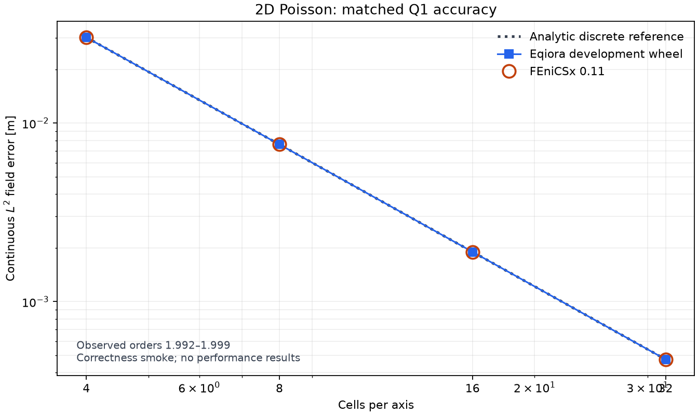

# 2D Poisson accuracy smoke with FEniCSx

Eqiora and FEniCSx reproduced the existing analytic Q1 error reference on four
uniform square meshes. Observed orders ranged from 1.992 to 1.999. Timing and
memory comparisons await optimized builds and a quiet reference environment.

These observations use a local **debug development wheel**, on a shared host.
The wheel's distribution version is 0.1.5; published Eqiora 0.1.5 does not include
this Scalar workflow. Use the [development build instructions](
../site/src/content/docs/get-started/index.mdx#development-build) to run it.

## Accuracy

The [predeclared protocol](../../tools/benchmarks/poisson_fenicsx/README.md)
fixes the problem, quadrature, solver settings and measurement boundaries.
Both tools use quadrilateral Q1 elements and the same supported BiCGStab policy.
The expected continuous errors come from the existing
[80-digit analytic discrete solution](../../verify/numerics/cartesian-poisson-fem-fvm/references/README.md),
with its existing comparison allowance. This is a regression comparison,
not a certified bound on either external backend's floating-point arithmetic.

| Cells per axis | Eqiora continuous L2 error (m) | FEniCSx continuous L2 error (m) |
| ---: | ---: | ---: |
| 4 | 0.0301801696 | 0.0301801696 |
| 8 | 0.00758721380 | 0.00758721380 |
| 16 | 0.00189970457 | 0.00189970457 |
| 32 | 0.000475111668 | 0.000475111668 |

The potential is dimensionless. Integrating its squared error over a physical
two-dimensional domain in metres gives an L2 norm with unit metres.

Each tool passed its true-residual acceptance and the analytic error allowance
at every level. The single-mode load makes this a narrow assembly and
correctness workload; general solver convergence needs additional cases.
Three-dimensional Poisson, elasticity, cylinder flow, MPI and GPU comparisons
remain future work.

## Environment and evidence

The [observational receipt](2026-11-05-poisson-fenicsx-correctness.json) records
source and wheel identities, exact runtime versions, MPI library, CPU affinity,
thread settings, effective solver policy, phase inventory, and the observed
coefficients paired with their grid points. It contains no timing or memory
comparison. Expected values remain in the independent analytic reference,
rather than being copied from these observations.

The smoke ran on one logical CPU of an Intel Xeon Gold 6346 host. FEniCSx used
DOLFINx/Basix/FFCx 0.11, UFL 2026.1, real PETSc 3.25.6 and MPICH 5.0.1, from the
[checked-in environment lock](../../tools/benchmarks/poisson_fenicsx/pixi.lock).
Eqiora used the serial reference adapter. Each child ran separately with one
thread, and the FEniCSx child dropped foreign loader and MPI overrides.

Two initial attempts failed. First, the ordinary Eqiora 2D Plan rejected CG
because its current stronger Q1 SPD proof covers one-dimensional intervals.
Both tools changed to BiCGStab before any comparison solve. Next, computed
FEniCSx DOF coordinates failed the exact-grid export check. Export now uses
topological Q1 vertex-to-DOF and vertex-to-Geometry bindings, without snapping
or a wider coordinate tolerance. The analytic error and residual allowances
were unchanged.

A separate control with the older Eqiora wheel confirmed that missing solve
telemetry stops benchmark mode before its warm timing loop. The new debug wheel
passed assembly and linear-solve phase-inventory checks at every mesh level.
Their durations are intentionally absent here.

## Reproduce

Follow the [locked-environment and installed-wheel commands](
../../tools/benchmarks/poisson_fenicsx/README.md#reproduce-a-correctness-smoke).
The driver writes separate tool receipts and candidate fields, then writes a
summary only when all requested levels and convergence checks pass. The six
standalone analytic and admission tests also pass.

This report advances the two-dimensional accuracy part of the external
comparison. A complete performance report still needs authenticated optimized
builds, matched operation scopes and a quiet, recorded environment.
