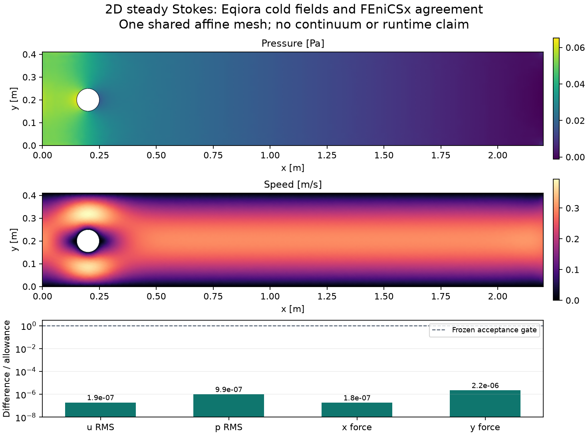

# Ordinary steady-Stokes cylinder: single-mesh correctness

This compares the actual finite channel and cylinder
in the shipped `steady-flow-past-cylinder.eqi` example. It uses the public
`Eqiora.Fluid` steady-Stokes components, GeometryGraph, Gmsh mesh and MINI
P1-plus-cell-bubble velocity/P1 pressure lifecycle. The channel is 2.2 m by
0.41 m with a circular hole of radius 0.05 m centred at (0.2 m, 0.2 m).
Dynamic viscosity is 0.001 Pa s; the inlet parabola has maximum speed 0.3 m/s.
Walls and cylinder have zero velocity. The outlet has zero full Cauchy
traction; no zero-mean pressure constraint is added.

The comparison transfers the public Eqiora mesh coordinates, triangle
connectivity and named boundary entities to FEniCSx 0.11, preserving the same
polygonal mesh and boundary partition. No private model/result JSON or
alternative physics implementation supplies Eqiora's side. FEniCSx uses its
independent standard finite-element assembly of the same Stokes problem.

Geometry, mesh, public compilation, function-space and field-export
preparation are implemented. The reviewed specification below fixes the force
reference and empirical budget algorithm before numerical observations. The first
external reference batch, one native candidate worker and its separate
assembly-only audit now pass. No timing campaign or continuum-convergence
qualification is claimed.
DFG/Navier–Stokes benchmark numbers are not Stokes reference values.

The shared measurement owner records the native worker. Later paired
campaigns use the existing shared child-process owner. This directory does
not own another measurement loop.

## Reviewed mathematical specification

The primary mathematical review accepts a discrete comparison against the
independently assembled FEniCSx MINI solution on the same affine mesh. This
supports agreement on that polygonal domain, not analytic continuum cylinder
drag. The cylinder centre is below the channel midpoint; zero lift is not an
acceptance condition.

Use sigma = 2 mu epsilon(u) - p I, with no body force, and

```
a((u,p),(v,q)) = integral(2 mu epsilon(u):epsilon(v)
                         - p div(v) - q div(u))
epsilon(u) = (grad(u) + transpose(grad(u))) / 2
```

Both pressure couplings have the same negative sign. The outlet has zero full
Cauchy traction, including its tangential component. There is no pressure
point constraint, mean subtraction, multiplier or constant-pressure nullspace.
A vector-Laplacian do-nothing outlet would describe a different problem.

Transfer public mesh coordinates, triangle connectivity and labelled boundary
edge vertex pairs. Map DOLFINx-reordered vertices, cells and facets by original
input identities. Check vertex/cell bijections, positive cell areas, complete
boundary coverage, edge incidence, fluid area and clockwise hole orientation.
Do not infer cylinder tags from midpoint distance to the exact circle.

The velocity span is P1 plus b = 27 lambda1 lambda2 lambda3, independently in
each component; pressure is continuous P1. There are 3 Nv + 2 Nc full scalar
unknowns and 3 Nv + 2 Nc - 2 ND free unknowns, where ND counts distinct
Dirichlet velocity vertices. Eqiora coefficients are hierarchical. Basix's
installed enriched basis is nodal at the three vertices and centroid, so the
conversion is

```
beta_cell = u(centroid) - (u(vertex1)+u(vertex2)+u(vertex3))/3.
```

Verify the reconstructed polynomial at additional interior points; raw Basix
coefficient equality is not the comparison. Store both components of the
public vertex velocity and cell-bubble coefficients and the pressure at every
vertex, in original mesh order. Shared serialization must retain every one of
these associations before any accuracy rejection.

Eqiora's assembly uses three-point Gauss on each Duffy axis. The stiffness is
degree at most four and pressure coupling at most three. Verify any external
assembly rule against reference-triangle monomials a! b! / (a+b+2)! through
total degree four. A different independently exact rule is allowed only with
its distinction and roundoff allowance recorded. Use degree-six integration
for the velocity L2 difference, since the bubble is cubic. Symmetrically
eliminate prescribed velocity values with lifting; restrict a full identity-row
FEniCSx system to the same free unknowns before system comparison. Preserve
wall values at outlet corners.

## Cylinder force and flux

For each component, construct a continuous P1 virtual velocity w which is the
component unit vector at cylinder vertices and zero at all other vertices.
Its hierarchical bubbles vanish. In the nodal Basix basis its centroid values
must equal the mean of its three vertex values. Independently assemble

```
R_i = integral(2 mu epsilon(u):epsilon(w_i) - p div(w_i)).
```

R is the force on the fluid; -R is the force on the cylinder, in N/m. Compare
them to the public `boundary_force(...).on_domain` and `.on_selection`,
respectively. This volume virtual work corresponds to Eqiora's sum of original
constrained momentum residuals. Raw boundary stress integration is a separate
diagnostic, not a solver-tolerance oracle for this discrete reaction. Changing
the virtual lift by a function zero on essential boundaries must change force
only by the corresponding free momentum residual.

For inlet segment lengths h_j, the exact flux magnitude of the nodal P1 trace is

```
Q_in,h = 2 U H / 3 - (2 U / (3 H^2)) sum(h_j^3),
U = 0.3 m/s, H = 0.41 m.
```

Signed inlet flux is negative. The continuum parabola's 0.082 m²/s is not the
algebraic flux oracle. Test weak continuity and global flux balance; MINI does
not have pointwise zero divergence. Sum global essential reactions over the
union of constrained vertices once, avoiding inlet/wall corner double counts.

## Reference acceptance meaning

Use independent direct solvers (Eqiora SparseLU/Faer and an available locked
PETSc factorization), float64, recording the actual backend and independently
computed free residuals. A direct solver's nominal relative tolerance does not
establish a forward-error bound. Fix scales from inputs: velocity U, length H,
pressure mu U/H and force per depth mu U. The primary-reviewed algorithm below fixes the
external-only engineering budget before any solved output is read.
Reference conditioning, adjoint residuals, assembly/basis conversion and force
reduction roundoff must be accounted for separately. No numerical drag, lift,
field or force tolerance is selected by this preparatory implementation.

The first campaign uses the explicit empirical algorithm below, without a
claimed certified inverse bound or an additional adjoint solve.

Required falsifiers include reversed force sign, omitted bubbles, symmetric
gradient replaced by vector Laplacian, an added pressure gauge or pressure
shift, missing inlet lifting, wrong cylinder tags and reordered DOFs/cells.
Reject an engineering allowance broad enough to admit these changes. No timing
or candidate solve runs until the primary explicitly authorises the frozen
reference calibration and candidate accuracy stages.

## Frozen first-reference-batch algorithm

The primary review has now selected the following empirical engineering gate.
It is an agreement-resolution requirement, not a certified forward-error or
continuum-error bound. Numerical budget values must come exclusively from the
external batch before Eqiora runs. The initial mesh is the ordinary example
mesh above; later actual-cylinder mesh levels remain required for a broader
campaign.

Run exactly three external solutions in this order, with one rank/thread and
float64, no pressure gauge and the same nodal inlet/no-slip lifting:

| Label | Direct implementation | Assembly quadrature |
| --- | --- | --- |
| A, designated reference | PETSc preonly + LU + MUMPS | positive nine-point Duffy, three Gauss points per axis |
| B | PETSc preonly + LU + serial SuperLU | the same Duffy rule |
| C | PETSc preonly + LU + MUMPS | positive Basix degree-six Gauss–Jacobi, sixteen points |

Both distinct implementations are present in the unchanged locked environment;
SciPy is not installed or required. No fourth reference is planned. Keep the
factorization defaults and record actual PETSc type, options, implementation,
precision and convergence reason. Do not select a different reference after
seeing a candidate. All physical norms and volume virtual-work forces use the
same independent degree-six observation route.

The common coefficient order is original vertex velocity components, original
cell hierarchical bubble components, then original pressure vertices. Apply
the explicitly constructed enrichment basis congruence before essential
elimination. With Dv diagonal (U for both velocity associations, P = mu U/H
for pressure), form

```
xhat = inverse(Dv) x
Ahat = transpose(Dv) Aphysical Dv / (mu U^2)
bhat = transpose(Dv) bphysical / (mu U^2).
```

Let eps be float64 epsilon, m be the maximum nonzero row count plus two,
gamma = m eps/(1-m eps), and
D = ||Ahat||inf ||xhat_A||inf + ||bhat||inf. Reject if m eps >= 1 or D is
nonpositive/nonfinite. Freeze r_cap = 100 gamma D. Every A/B/C residual and
the later candidate residual must satisfy this same infinity-norm ceiling on
the designated-A operator. Export its CSR arrays, RHS, free indices and scales
in a standard NumPy archive. Read with `allow_pickle=False`, verify file hash,
all dimensions, integer bounds, free-index bijection and declared scaling.
The Eqiora environment evaluates this external operator with NumPy; it does
not need PETSc or another PDE assembly.

For each of four metrics independently (complete velocity RMS, pressure RMS
without mean removal, cylinder x force, cylinder y force), set

```
s_Q = U, P, mu U, mu U respectively
S_Q = max(s_Q, reference amplitude of A)
delta_Q = maximum physical difference over all A/B/C pairs
tau_Q = max(sqrt(eps) S_Q, 10 delta_Q)
broad_cap_Q = 1e-4 S_Q.
```

Field RMS is sqrt(integral(|field|²)/fluid area), using degree-six integration
of the complete MINI polynomial. Each force uses its own amplitude and floor;
lift never borrows drag's magnitude. All comparisons are absolute in their
physical units. The candidate must satisfy d_Q(E,A) <= tau_Q.

Before freezing, compute material-mutant distances from A. Velocity uses the
smaller RMS distance to zero velocity and to removal of all hierarchical
bubbles. Pressure uses the smaller distance to zero pressure and addition of
constant P. Drag uses min(abs(Fx,A), mu U). Lift uses mu U. Require

```
tau_Q <= min(broad_cap_Q, material_mutant_distance_Q / 20).
```

Run zero-velocity, omitted-bubble, zero-pressure, pressure-shift, zero-drag,
reversed-drag, one-force-scale drag/lift shifts through the actual agreement
gate and require rejection. Also reject zero/reversed lift when abs(Fy,A) is
at least mu U; otherwise do not claim its sign is numerically resolved. A
failed cap is inconclusive. It cannot increase the margin or remove a
falsifier. The factors 100, 10, 1e-4 and 20 and sqrt(eps) floor were fixed by
the primary mathematical review before any solved output.

Check nodal boundary traces with a declared 256 eps U arithmetic margin and
analytic discrete inlet flux with 256 eps U H times the inlet edge count.
Summing all free pressure equations gives a net-flux allowance
Nv U H r_cap plus that input-only arithmetic margin. A separate global reaction control sums the uneliminated canonical momentum
residuals over the essential-vertex union once and allows
Nv mu U (r_cap + 256 eps), in N/m. Retain the public force action–reaction
pair exactly, not merely one signed component. These are separate
trace/continuity/equilibrium controls, not the four field/force tolerances.

`calibrate.py --mesh MESH_JSON --output NEW_DIRECTORY` implements this batch.
It records each reference observation, original mesh identities, quadrature,
source and installed environment, common-operator files and their hashes.
Only a completely accepted batch writes `reference-manifest.json`; failure
retains attempts but produces no frozen candidate budget. Candidate collection
must verify this manifest and cannot recalibrate it. The initial external-only batch has completed successfully under its original
frozen harness. Its immutable manifest and artifacts are read and hash-checked
by the candidate consumer; the candidate does not recalibrate them.


## Candidate and independent reconstruction

`eqiora_case.py` reopens the exact public Mesh artifact and reauthors its
unchanged GeometryGraph, checks both identities and original topology, imports
the shipped standard package and resolves ordinary MINI/SparseLU/Faer with the
example's original controls (relative 1e-6, absolute 1e-13, at most 10000
iterations, identity preconditioner, fast reduction, no scaling). Those native
solver settings do not replace the frozen external residual/accuracy gates.

The shared correctness-only lifecycle performs one cold Eqiora call and one
separate profile call, with no warmups or timing samples. Only the cold field
is the candidate. Shared serialization retains velocity vertices, every cell
bubble, pressure vertices, both cylinder-force signs and public inlet/outlet
flux before accuracy checks. Public Plan/Result bytes are retained separately.
The reader validates the manifest, original mesh artifact, all reference and
operator file hashes, A/B/C policy, free basis, scales and gauge absence before
running. It enforces force action–reaction, input-derived trace/flux controls,
the frozen external CSR residual and all four physical metrics.

The unchanged public geometry has no runtime selection union for all essential
vertices. Do not sum separately named native reactions and double-count their
corners. `audit_candidate.py` instead performs a separate FEniCSx assembly-only
reconstruction from the retained cold MINI coefficients, using the verified
basis correspondence. It performs zero PDE solves. It evaluates UFL cylinder
virtual work against the unchanged frozen force allowances and sums the global
essential-vertex union once against the unchanged conservation allowance.
This is an independent reconstruction, not a native Eqiora union-force export.
The receipt binds candidate bytes, worker source/artifact identity and the
frozen reference hash; its process/memory are separate from the native worker.


## Recorded single-mesh result

The [correctness record](results/correctness.json) qualifies the initial mesh
only: 2386 vertices, 4512 triangles, 16182 full scalar unknowns and 15694 free
unknowns. Three external reference solves preceded the native candidate. The
one native worker made one cold call and one separate profile call, with no
warmups or timing samples. The independent reconstruction made zero PDE solves.
Every process exited successfully; the original source/artifact identities are
kept separately in the record.

| Cold candidate metric | Difference from FEniCSx A | Frozen absolute allowance |
| --- | --- | --- |
| Complete velocity RMS | 8.64e-16 m/s | 4.47e-9 m/s |
| Pressure RMS | 3.21e-16 Pa | 3.23e-10 Pa |
| Cylinder x force | 1.73e-17 N/m | 9.46e-11 N/m |
| Cylinder y force | 9.93e-18 N/m | 4.47e-12 N/m |

The native external-operator residual, prescribed trace, analytic discrete
inlet flux, force action–reaction and all four agreement metrics pass. The
independent UFL reconstruction also passes the unchanged force, flux and
global essential-union reaction controls. All eight mandatory external
falsifiers were rejected. This is empirical agreement on one shared polygonal
affine mesh, not continuum cylinder accuracy, a refinement study, or a tool
speed ranking. Further actual-cylinder meshes remain required.

The actual native profile contains linear solve, symbolic/numeric
factorization and backsolve, but lacks an assembly phase. Cylinder timing
therefore remains unavailable for this optimized artifact; the focused
[profiling prerequisite](https://github.com/eqiora/eqiora/issues/1864) must be
qualified before a later timing campaign.

<picture>
  <source media="(max-width: 600px)" srcset="results/single-mesh-mobile.png">
  
</picture>

The mobile figure shows a near-cylinder detail of the same full-channel
solution. Display sampling subdivides each triangle to show the complete
cubic MINI velocity, including its bubble. The plotted color interpolation is
only a display; acceptance uses degree-six integration of the full physical
polynomial, not these samples.

## Recheck and reproduce from a clone

`recheck_saved.py` verifies the [raw inventory](results/raw-sha256.json), loads
the original committed reference manifest/operators and cold candidate bytes,
and reruns the complete pure-NumPy candidate gate, including the frozen CSR
residual. It also checks the integrity-bound original UFL audit's cold-field
identity, recorded force/global reaction/flux against unchanged bounds. It
does not reassemble UFL or run another PDE solve. `plot_fields.py` invokes this
same gate before rendering either figure with NumPy and Matplotlib.

Successful numeric/reference/operator and public Mesh/Plan/Result artifacts
are committed byte-for-byte. The native process summary is explicitly a
projection omitting one machine-local loader path; its original receipt stays
externally retained with the original digest. Full external JIT/log inventories
are retained separately. No projected record is labelled an original raw file.
