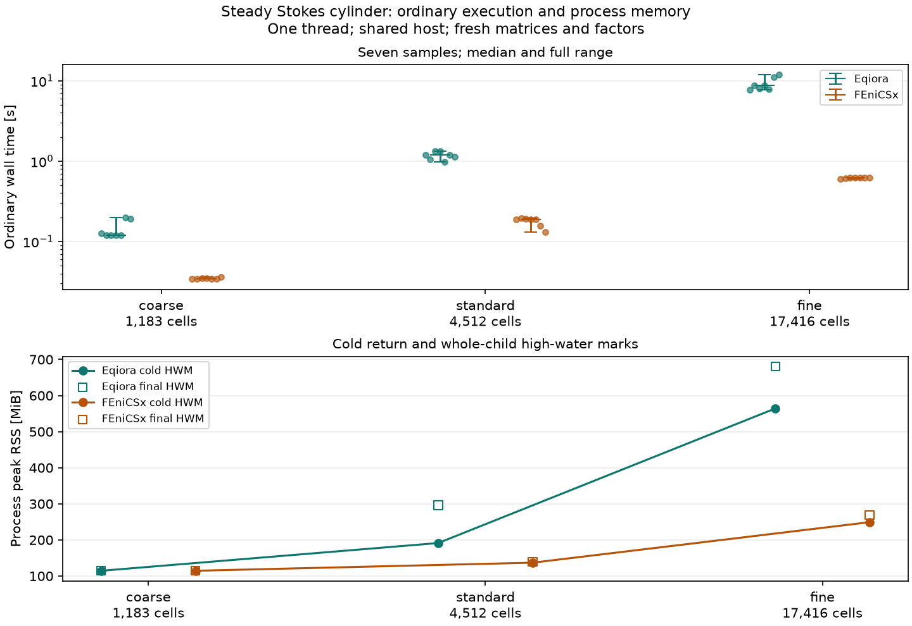
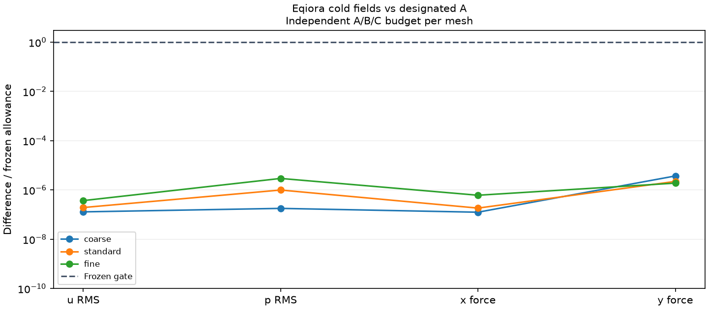

# Three-mesh steady Stokes cylinder comparison

Eqiora and FEniCSx passed the complete frozen agreement gates on three shared
cylinder meshes. One subsequent ordinary-execution campaign retained seven
samples per tool and mesh. These are observations from a shared host, not a
stable performance baseline or a continuum drag-accuracy result.

The [physical problem and reference definitions](../README.md) and
[input-declared mesh and execution protocol](../MULTIMESH.md) apply unchanged.
The original single-mesh result remains separate. Every mesh used the same
finite channel, circular-hole geometry, MINI velocity/P1 pressure, inlet and
full-stress outlet. Each affine polygonal mesh was transferred to FEniCSx through
its original vertex/cell identities. No pressure gauge was added.

## Ordinary execution

| Mesh | Vertices / cells | Free unknowns | Eqiora median [range], s | FEniCSx median [range], s |
| --- | ---: | ---: | ---: | ---: |
| coarse | 657 / 1,183 | 4,091 | 0.1202 [0.1192, 0.1987] | 0.03442 [0.03403, 0.03603] |
| standard | 2,386 / 4,512 | 15,694 | 1.1936 [0.9863, 1.3388] | 0.18721 [0.13184, 0.19410] |
| fine | 8,967 / 17,416 | 60,761 | 8.7206 [7.7323, 11.8410] | 0.62006 [0.60208, 0.62806] |



Each fresh worker made one cold call, one separate profile call, two warmups and
seven timed ordinary calls: 60 ordinary calls plus six profile calls, with 42
timed samples. Both tools allocated fresh matrices, right-hand sides and direct
factorizations on every call. Eqiora used its ordinary `run(plan)` with
`eqiora.faer` sparse LU; FEniCSx used designated policy A, PETSc/MUMPS with the
Duffy quadrature. The different solver implementations are part of these
observations.

Eqiora's ordinary call includes its native assembly, accepted solve and field
return. FEniCSx includes new system assembly, hierarchical-basis congruence,
essential lifting, factorization/solve, physical and scaled residual summaries,
mixed-field recovery and system cleanup. FEniCSx retains compiled forms, the
mesh/space and immutable basis data, never a solved system or factorization.
Force/flux functionals, export, frozen-reference checks and output inspection
are outside both ordinary clocks. Plans, model compilation, provider mesh work
and FEniCSx JIT preparation are also outside. Internal phase scopes are not
asserted to be identical. All required native phases were present; no phase
was inferred by subtraction.

The separate mesh-setup and profile measurements are shown below. Each is one
observation per worker, not a median of the ordinary samples. Mesh setup means
reopening the fixed mesh and checking its export in Eqiora, and `create_mesh`,
MINI space/boundary construction and basis mapping in FEniCSx; it excludes Gmsh
generation. Preparation means model compilation/resolution in Eqiora and fresh
form/JIT compilation in FEniCSx.

| Mesh / tool | Mesh setup, s | Preparation, s | Profile assembly, s | Profile linear, s |
| --- | ---: | ---: | ---: | ---: |
| coarse Eqiora | 0.02061 | 0.07370 | 0.05216 | 0.04130 |
| coarse FEniCSx | 0.07637 | 1.15635 | 0.01342 | 0.02261 |
| standard Eqiora | 0.27105 | 0.68757 | 0.37968 | 0.12632 |
| standard FEniCSx | 0.26547 | 1.28916 | 0.05189 | 0.13672 |
| fine Eqiora | 2.56660 | 4.52252 | 5.29280 | 0.91605 |
| fine FEniCSx | 1.23825 | 1.87598 | 0.14507 | 0.46295 |

Eqiora assembly is its native `mini_stokes_finalization` span; linear includes
native faer symbolic/numeric factorization and two backsolves, including its
acceptance correction. FEniCSx assembly includes allocation, basis congruence
and lifting; its linear phase includes KSP/MUMPS setup, solve, true-residual
summaries and solver/vector cleanup. FEniCSx recovery and matrix cleanup remain
separate recorded phases. These boundaries differ. The profile comes from a
separate instrumented call, so its spans must not be added to or subtracted from
the ordinary median, or interpreted as equal internal work across tools.

The memory figure shows the process high-water mark immediately after the cold
field return, before inspection/accuracy/profiling, and the final whole-child
high-water mark. Both include imports, preparation and reference data already
loaded at that point. Final memory includes untimed diagnostics and repeated
calls. Completed-child peaks are retained separately in reports and are not
an aggregate process-tree memory measurement.

The run used one thread/rank on CPU 20 of an Intel Xeon Gold 6346 host, with GPUs
hidden. The supervisor used CPU 21; their SMT siblings are 52 and 53. Governor,
frequency snapshots, process CPU snapshots and sampled descendants/load are
retained. The host had substantial concurrent work (initial load average about
30). Siblings were not reserved and frequency was not fixed. This campaign
supports the reported samples and ranges, not an idle-host or stable-baseline
claim. Package versions and actual producer identities are recorded in
[the provenance record](record.json) and retained reports.

## Agreement and mesh sensitivity

Each mesh's independent A/B/C reference batch completed and froze its budgets
before any candidate ran. All eight material falsifiers were rejected per mesh.
Six subsequent correctness workers and three assembly-only FEniCSx
reconstructions passed before timing was authorized. Each benchmark worker's
fresh cold fields passed the same complete gate; timed samples were not used
to select candidate fields or adjust a threshold.



The replay checks complete vertex velocity, cell bubbles and vertex pressure,
the independent designated-A CSR residual, cylinder force pair, essential trace
and analytic discrete inlet/continuity flux gates. It also checks the retained
independent reconstruction's cylinder forces, global essential-union reaction
and boundary fluxes against their unchanged bounds. The latter are stored
assembly-only observations from imported Eqiora fields, not a native Eqiora
union-reaction export or a new PDE solve.

| Mesh | Designated-A cylinder x force, N/m | Designated-A cylinder y force, N/m |
| --- | ---: | ---: |
| coarse | 0.00652703755 | 0.0000723958468 |
| standard | 0.00635130522 | 0.0000622655347 |
| fine | 0.00630127200 | 0.0000606714754 |

The intrinsic two-dimensional forces are per unit out-of-plane depth, matching
the public typed getter dimension (mass/time²), not three-dimensional forces.
These changes describe mesh sensitivity on the actual finite-channel problem.
They establish neither an extrapolated continuum value nor a convergence order.
The cylinder is offset from the channel midline, so zero lift is not an oracle.
No Navier–Stokes/DFG benchmark value is used as a Stokes expectation.

## Recheck from a clone

With Python and NumPy, run from the repository root:

```sh
python -B tools/benchmarks/cylinder_fenicsx/multimesh/recheck.py
```

The reader verifies the compressed archive and its per-file inventory, extracts
into home-backed scratch, then calls the existing reference, candidate,
stored-audit and report owners. It independently reruns the complete scientific
gates and recomputes all medians/ranges from the retained samples. It requires
neither Eqiora nor FEniCSx, and performs no PDE solve. To redraw the figures,
add Matplotlib and run the sibling `plot.py`. Both figures are also supplied
at [320-pixel width](runtime-320.png) and
[320-pixel agreement width](agreement-320.png).

The [archive inventory](artifact-inventory.json) explicitly distinguishes original
bytes from public metadata projections. Scientific field/operator/reference
files and sample numbers are preserved. FEniCSx result projections omit only
`environment.mpi_library`, whose vendor build configuration contains machine
paths. Reference supervisor projections omit only inherited executable-search
paths. Original and public SHA256 values and every omitted field are recorded.
Genuine worker receipts remain unchanged and retain the original result hashes;
no receipt is rewritten to pretend a projection was its original result.
The strict reference loader still verifies each original manifest and its
`reference-launch.json` against `manifest.launch_sha256`: these files contain
no inherited search path and remain original bytes. The separate outer
`reference-controls/launch-plan.json` and supervisor receipts are the PATH
projections; they are not substituted for the manifest-bound launch record.
The archive contains 127 original files and ten explicitly labelled metadata
projections. JIT binaries/caches are excluded. Other original artifacts remain external with
their recorded digests.

Accordingly, clone replay checks scientific observations and the labelled
receipt/projection chain. It does not claim the original report byte stream can
be recovered from a projection, or requalify a newly changed harness for timing.
The actual campaign and calibration source identities remain those in the
record. The later reader/helper extraction has a separate Git identity.

The first correctness launch stopped before creating a child because the
collector's initial affinity excluded the worker CPU. Its exit receipt and
error log remain recorded; the explicitly corrected launch made the six workers.
An initial read-only summary print also failed after qualification passed;
the corrected read-only validation exited successfully. Neither event reran a
numerical candidate. All six benchmark workers passed in their first attempt.
