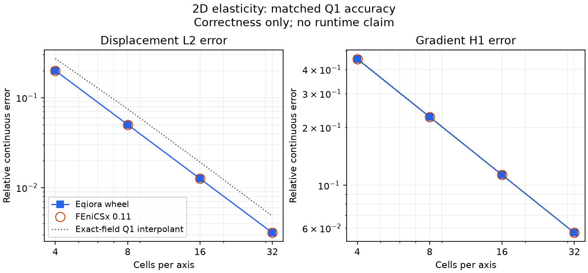

# Ordinary two-dimensional elasticity comparison (protocol)

This protocol is declared before candidate observations. The protocol was committed before candidate observations. The
[correctness record](results/correctness.json) now qualifies the stated accuracy
gates; no timing campaign has run. It compares the shipped
`Eqiora.Solid.LinearElasticity.IsotropicBalanceWithPotential2d` component through
ordinary compile → resolve → run against FEniCSx 0.11 quadrilateral Q1 elasticity.
It covers intrinsic two-dimensional, constant-coefficient small-strain elasticity,
not plane stress/strain, dynamics, 3D, or a general material model.

## Problem and independent reference

Use the unit square in metres, homogeneous displacement on every side,
mu = 3 Pa, lambda = 2 Pa, q0 = 1 Pa and k = pi / m. Set

```
q = q0 (sin(kx)^2 + sin(ky)^2 - 4 sin(kx)^2 sin(ky)^2)
Psi = q0 sin(kx)^2 sin(ky)^2 / (2 k^2 (lambda + 2 mu))
u = -grad(Psi)
sigma = 2 mu sym(grad(u)) + lambda div(u) I
-div(sigma) = grad(q)
```

The derivatives commute, so div(sigma(-grad(Psi))) equals
`-(lambda+2mu) grad(Delta(Psi)) = -grad(q)`. Both displacement
components vanish on every side. This nonaffine manufactured reference and
convergence thresholds already have independent derivations in
[the isotropic-elasticity reference](../../../verify/solid/isotropic-elasticity-2d/references/README.md)
and [its acceptance contract](../../../verify/solid/isotropic-elasticity-2d/expected/README.md).
For A = q0 / (2 k (lambda+2mu)), the exact squared displacement L2 norm is
`3 A^2 / 8`; the exact squared gradient seminorm is `2 k^2 A^2`, by direct
integration of sine/cosine squares. These provide independent normalization.

## Controls and falsifiers

Use square affine Cartesian cells at N = 4, 8, 16, 32 per axis; vector Q1,
float64, two-point tensor Gauss integration for assembly, the same potential
and full zero Dirichlet boundary. Keep fresh assembly and solve inside ordinary
execution. Mesh/form/Plan preparation is outside it. Neither tool may reuse an
assembled matrix, factorization, preconditioner or solved field across calls.
Use reference CG with identity preconditioning, relative tolerance 1e-12,
absolute tolerance 1e-14 and maximum 10000 iterations in both tools, provided
the public Eqiora resolver admits CG for this ordinary elasticity path. A typed
rejection is a missing prerequisite, not permission to silently switch policy.
Recompute and check the true algebraic residual against
`max(1e-14, 1e-12 ||b||_2)`, excluding essential rows identically in both tools.

Export vector nodal values through public APIs with authoritative mesh vertex
coordinates and verify a bijection with the dyadic grid; do not fit a coordinate
tolerance to an observed tabulation. Compute continuous displacement L2 and
gradient seminorm errors by independent tensor Gauss integration of the Q1
reconstruction. Ten points per axis per cell integrate errors; repeating with
12 must change either norm by at most 1e-10 relative plus 1e-14 absolute.
All values must be finite. Boundary values must have magnitude at most 1e-14.
Relative L2 and H1 errors must each be below 1 (zero displacement fails).
Errors must decrease strictly; the last two L2 orders must be at least 1.9
and H1 orders at least 0.9, as in the established manufactured case. Cross-tool
agreement does not replace either tool's independent analytic gates.
Component swaps, zero/negated fields, missing nodes and changed boundary
values must fail appropriate oracle gates in pure tests.

The symmetric load has zero resultant. A separate q = x Pa/m probe checks
nonzero integrated force (1,0) N/m and reaction (-1,0) N/m; it is an equilibrium
falsifier, not the sole accuracy case. Use the established equilibrium allowance
`5e-11 * max(1, |reaction_i| + |force_i|)` N/m. Do not infer equilibrium from
zero resultants alone.

## Measurement boundary and shared utility

No timing campaign starts until protocol review, both tools' correctness and
an allocated CPU/monitoring window. Reuse the existing Poisson process monitor,
artifact provenance and thread/CPU controls. The shared execution owner accepts
an injected accuracy callback and a vector-safe candidate serializer. Problem-local code
owns vector norms, component topology and equilibrium, not a second private
measurement framework. This directory does not modify that shared owner.

When that interface is available, use one thread/rank, a pinned isolated CPU,
one fresh process per tool and level, one cold execution, one separate profile
diagnostic, one further untimed affine-load equilibrium probe after the cold
execution, two warmups and seven timed ordinary executions. Preserve all raw
attempts, candidate fields, imports, preparation, memory, environment, installed
wheel and FEniCSx provenance. Profile phases are diagnostic calls, not inferred
subtractions from ordinary timings. No stable performance claim follows from
correctness-only smoke or a busy host. Actual optimized wheel producer identity
must be retained independently of any later tree-identical signed commit.

The FEniCSx assembly diagnostic includes fresh matrix/vector allocation and
assembly, lifting, ghost accumulation and essential boundary application. Its
linear-solve diagnostic includes KSP allocation/configuration, the zero start,
solve, independently recomputed true residual, summary getters and KSP/residual
cleanup. Function allocation, field recovery, scatter and solution-vector
cleanup occur inside the ordinary execution after those brackets. Essential
row/column checks, output inspection and retained matrix/RHS destruction occur
outside ordinary execution. Eqiora records its ordinary public `run` call and
separate native profile as supplied by the core. Internal phase scopes and
object lifetimes are not asserted to be identical between tools; phase tables
cannot be subtracted from ordinary call times or treated as equivalent work.

## Running correctness checks

Run the pure analytic tests with a NumPy environment:

```sh
python -m unittest discover -s tools/benchmarks/elasticity_fenicsx -p 'test_*.py'
```

The `eqiora_case.py` and `fenicsx_case.py` worker commands take explicit
`--mode correctness-only --cells N --output /home/.../report.json` arguments.
The Eqiora command additionally requires `--wheel`, `--revision` (actual build
producer), and `--build-profile release`. Use the shared monitor's one-CPU
affinity and one-thread environment controls for either worker. Each FEniCSx
output parent must have a fresh JIT cache. Recheck all eight output reports with
`validate.py report...`; this recomputes field accuracy and convergence rather
than accepting stored accuracy summaries. The common measurement helper must
be present in the checkout before running workers.

## Correctness observation

Both tools passed all four declared mesh levels through the shared fresh-child
collector. Continuous L2 orders were 1.9953, 1.9946 and 1.9984; gradient H1
orders were 1.0004, 1.0003 and 1.0000. Each tool independently passed the
analytic field, true-residual, essential-boundary and nonzero-load equilibrium
gates. This is evidence for this manufactured Q1 problem and optimized
development wheel. It is not a distribution-profile qualification or runtime
comparison.

The [record](results/correctness.json) identifies the actual wheel producer and
frozen harness separately. The [raw inventory](results/raw-sha256.json) binds
the retained reports, candidate fields, logs and artifact receipt. Failed
adapter attempts remain in the parent scratch directory described by the
record; they did not change the analytic reference or acceptance tolerances.

<picture>
  <source media="(max-width: 600px)" srcset="results/accuracy-mobile.png">
  
</picture>

The dotted curve is the Q1 interpolant of the exact analytic displacement,
computed independently of either PDE solve. It is a visual comparison, not an
expected candidate solution. Reproduce both images with `plot_accuracy.py`
using NumPy and Matplotlib; the script first verifies the retained raw reports
against their hashes and re-evaluates their continuous errors.
