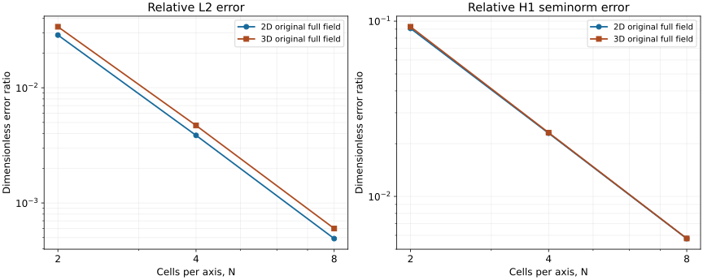

# Ordinary affine Q2 scalar diffusion

This case connects full Q2 quadrilateral/hexahedral fields to the ordinary Plan,
region compiler, assembly map, solver and Result codec. The installed-Python
N=2,4,8 sine witnesses pass the independent complete-field and finite-level
gates in both dimensions. The native polynomial witnesses separately pass the
unchanged rational coefficient, residual and physical reaction gates.

The [original evidence](evidence/sine-5f8130/inventory.json) distinguishes the
frozen native producer, original first-solve harness, corrected postprocessor
and remaining five solves. These are correctness results, not timing results.

The initial ordinary scope is static linear scalar diffusion, with real or complex
coefficients, on affine Cartesian quads/hexes in 2D/3D. P2 triangle/tetrahedron
reference bases and traces share the kernel; ordinary P2, vector quadratic spaces,
Taylor–Hood, nonaffine/curved geometry and prisms remain separate work. This case
adds no public scalar force or flux observation API. Unsupported samplers and
derived observations must reject complete quadratic fields rather than keep only
the vertices. CPU host-serial evidence here does not establish MPI/GPU behavior
or performance.

## Sine convergence protocol

The independent [reference and comparator](reference/README.md) own the mathematics,
fixed budgets, continuous physical L2 and H1 **seminorm**, finite-grid reference
rates and falsifiers. The boxes are [0,2]×[0,3] m and [0,2]×[0,3]×[0,4] m, with
N=2,4,8 cells per axis and homogeneous essential data on every face. The
manufactured dimensionless field is
`u=product_i sin(pi*x_i/L_i)`, and `f=pi²*sum_i(1/L_i²)*u` has units 1/m².
The theoretical limiting orders, L2 three and H1 seminorm two, are distinct from
the independently enclosed finite rates at these levels.

The failed three-point load audit is retained in the reference directory. The
production choice is explicitly four Gauss points per axis. Plan v28 must retain
that effective rule and replay it unchanged. It is not sufficient for the exported
coefficient file to declare four. The 1% load perturbation and 1e-3 combined
uncertainty budgets are unchanged; the comparator integrates the complete
candidate field with certified rational/analytic formulas. It does not project
onto sine amplitudes or use sampled field errors.

`check.py` imports an installed package and performs one ordinary call to
`eqiora.run`, on a reopened ordinary Plan. It uses the reference provider's
BiCGStab, identity preconditioning, reproducible reduction, relative tolerance
1e-13, absolute tolerance 1e-14 and maximum 100000 iterations. These solver inputs
do not replace the independent residual bound. The authored pi and forcing
parameters are ordinary binary64 inputs, recorded in the execution receipt; their
errors also enter the comparator's independently assembled residual.

Each invocation requires one caller-pinned CPU, one thread in OMP/OpenBLAS/MKL/Rayon,
and `CUDA_VISIBLE_DEVICES=''`. It creates a fresh output directory and retains
source, model, mesh, Plan, Result, candidate coefficients and producer metadata.
There is one Plan reopen and one Result reopen; neither is a second PDE solve.
There are no profile calls, warmups, timing samples or solution reuse. The fresh
Result is the candidate. Reopening must preserve every coefficient and exact
canonical bytes; the reopened Result cannot replace a failed original.

`production.py` checks the actual Plan schema/policy, actual full Cartesian vertex
and cell inventory, exact caller/output mesh identity, Result/Plan/Model linkage,
scalar type and units, canonical coefficient entities and all association counts.
Q2 has one nodal value per vertex, edge, face where present, and cell. Its nodal
points are affine entity centroids, computed from actual public mesh connectivity.
No field interpolation is involved. Every coefficient is exported as canonical
binary64 hex, and coordinates as exact decimal strings. Nodal cell-center values
are `cell`, never `cell-bubble`. The producer receipt binds the mathematical input
to the Plan/Result/mesh artifacts by SHA-256; the independent comparator consumes
only the mathematical input.

After review and execution authorization, run one fresh invocation for each
(dimension,N), in order (2,2),(2,4),(2,8),(3,2),(3,4),(3,8), stopping on failure.
The launcher must retain actual command, source/artifact/input identities,
terminal status and controls. Do not overwrite, retry a failed numerical outcome,
rebuild the candidate or change thresholds automatically. An example invocation
for a preselected CPU is:

```sh
taskset -c "$cpu" "$installed_python" check.py --dimension 2 --cells 2 --cpu "$cpu" --output "$fresh_output"
python3 reference/compare.py "$fresh_output/candidate.json" --output "$fresh_output/comparison.json"
```

The caller supplies the declared thread/GPU environment above. `check.py` exit zero
means **export completed**, not scientific acceptance. The comparator must exit
zero separately. After all three accepted levels in a dimension, assemble their
unmodified candidate objects into a JSON array and use `reference/compare.py
--levels` to check and report the complete finite-rate set. The ordinary export
script contains no private residual, norm or acceptance implementation.

## Polynomial patch and boundary reaction

A separate accepted N=2 witness uses the same physical boxes and
`u=product_i(1+(x_i/L_i)²)`. Its source is
`f=-sum_i(2/L_i²)*product_j!=i(1+(x_j/L_j)²)`, with units 1/m². The upper first-axis
face has essential data; all other faces have the analytic normal derivative.
This exercises nonzero boundary midpoint/face data and every nodal family. The
native existing `plan.linear_reactions` owner must retain all constrained physical
weak-dual coordinates. The upper sum is +4 in 2D and +64/3 m in 3D. These scalar
weak actions are not mechanical forces.

The independent [rational patch oracle](reference/POLYNOMIAL.md) owns the frozen
residual, coefficient and reaction budgets. The first native attempt failed typed
model compilation before any Plan or solve: an array literal was not a spatial
tensor. It executed zero ordinary solves. Equivalent scalar face fluxes now
passed compile/resolve-only preflight in both dimensions, then one reviewed
second attempt completed both ordinary solves and both independent comparisons.
The [original patch artifacts](evidence/polynomial-5f8130/README.md) are retained.
The producer uses
solver relative and absolute tolerances 1e-14, retains every actual field
coordinate and upper constrained reaction coordinate, and binds its mathematical
input to separate Model/Plan/Result/mesh producer receipts and the actual test
executable SHA. The producer prints its fresh artifact path before any solve and
never overwrites a previous attempt. Scientific acceptance requires the unchanged
external `reference/polynomial.py` gate; a producer test pass alone means exported.
Neither expectations nor allowances come from native output.

The native producer makes one ordinary solve in each dimension, one Plan reopen,
one successful Result reopen and one native reaction reconstruction per case.
It also checks honestly rehashed nonvertex field corruption, missing cell data and
an altered essential midpoint through the existing Result reader. These negative
reopens add no PDE solves. Set `EQIORA_Q2_POLYNOMIAL_OUTPUT` to a fresh home-backed
path for controlled execution. Otherwise the test uses a fresh path under HOME.
The launcher must record/pin one CPU and thread/rank controls and preserve the
actual terminal status and all partial artifacts on failure.

## Checks without candidate solves

```sh
python3 -B -m unittest discover -s . -p 'test_production.py'
python3 -B -m unittest discover -s reference -p 'test_*.py'
```

The first command uses synthetic public-protocol objects and imports no Eqiora.
It rejects missing cell coefficients, missing faces, aliased edges, incorrect
strata, a wrong effective rule, altered mesh inventory, wrong Result/Plan/Field
linkage, wrong units, nonfinite values and a bubble-labelled nodal cell. The second
command exercises the independent reference/comparator, including arbitrary
non-sine fields and controlled full-vector perturbations. Core tests separately
cover quadratic monomials/gradients, parent traces, topology-preserving cube
permutations, quadrature minima, effective-policy replay and stale prepared facet
geometry/order/quadrature. These pure checks are separate from the installed
scientific evidence above.


## Saved results and reproduction



The plot shows physical L2 error divided by the exact physical L2 norm, and H1
seminorm error divided by the exact gradient norm. Both ratios are dimensionless.
The exact norms use `||u||²=product(L_i)/2^d` and
`||grad u||²=pi² sum(L_i^-2) ||u||²`. The plotted values are midpoints of the
independently enclosed errors; their interval widths are smaller than the markers.
The script rechecks the committed fields before plotting. It adds no acceptance
threshold or fitted reference curve.

| Dimension | Full coefficients at N=2,4,8 | L2 finite rates | H1 seminorm finite rates |
| --- | --- | --- | --- |
| 2D | 25, 81, 289 | 2.891648, 2.978002 | 1.986303, 1.997961 |
| 3D | 125, 729, 4913 | 2.847143, 2.971611 | 2.007289, 2.005275 |

The original first sine worker completed its 2D N=2 solve but its exporter
incorrectly compared a run-request key with the Plan artifact identity. The
original failure remains retained. A reviewed read-only recovery reopened its
original Result byte-exactly and exported all 25 original coefficients; it did
not run another PDE. Five subsequent ordinary workers and every independent
comparison passed. The total is one original plus five new solves. An earlier
no-solve source-name lookup failure, a taskset spelling error, a read-only audit
property typo and a recovery helper path-type error also remain in the external
attempt logs. They did not change the numerical budgets or trigger another first
solve. A decoded Model selects its exact Field ULID; the live compiled producer
uses the canonical source alias `definition.u`.

The archive includes original scientific bytes and five explicitly labelled
execution metadata projections. Each projection omits only `native_module` and
`python`, which were machine-local paths; the inventory retains original and
public digests. Machine-local process/build receipts remain external and are
identified by their original digests. They are not represented as clone-available
original receipts. No JIT binary, native wheel or local environment is embedded.

From this directory, run:

```sh
python3 -B recheck_saved.py
```

This checks committed original digests, binds every exported binary64 value to
the complete original Result blocks and export coordinates, and repeats both
polynomial gates, all six full-vector sine gates and both finite-level gates
with the unchanged reference owners. It imports no Eqiora and performs no PDE
solve. It does not claim to rerun native artifact decoding or original process
receipts. `plot_evidence.py --output "$scratch"` repeats that check before
regenerating the figure with NumPy/Matplotlib.

The registered case uses the existing installed-wheel gate. Its isolated Python
test calls the same `check.run` producer and independent comparator for all six
sine cases, retaining fresh home-backed outputs and stopping on failure. The
native polynomial archive is complementary evidence; it is not misrepresented
as an execution of that registered installed-wheel target.
