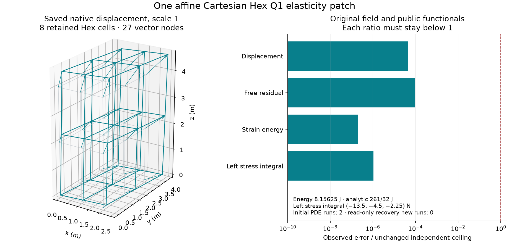

# Ordinary Cartesian Hex Q1 elasticity

The ordinary Rust and installed-Python paths solve the fixed affine,
small-strain isotropic patch in the [independent reference](reference/README.md).
Eight native Hex cells retain 27 vector nodes and all 81 displacement
coefficients. Public strain energy and left-face stress integrals are checked
against both the exported field and the analytic solution. These stress
integrals are not recovered private weak Dirichlet reactions.

Execution is serial CPU only. CPU-parallel, MPI and GPU paths remain unverified.
The Cartesian Mesh stores one coordinate list per axis and cannot express a
warped or non-affine Hex. Invalid/inverted/collapsed/non-finite axes and real
resource budgets exercise actual typed rejection paths; they do not establish
trilinear-map validity. Q2, reduced integration, near-incompressible robustness,
nonlinear behavior, dynamics, Prism, Pyramid, mixed cells, AMR and the broader
shared-cell work remain outside this case.

[model.eqi](model.eqi) supplies the equations, affine essential data, five natural
tractions, weak form and observables. Both clients use the shared compile,
resolve, Run and Result lifecycle with Q1 and explicit two-point Gauss rules.
The producer checks physical local corner ordering independently of global
vertex storage and binds exact Model, Mesh, Field, Observable, Plan and Result
identities through replay. Altered-component, sign, unit, contraction,
regularity, axis and local-node controls expose plausible mistakes.

The affine continuum displacement extends smoothly beyond the box. Its authored
`smooth` regularity supports classical stress traces; it does not assert smooth
gradients for general discrete Q1 fields. The weak test stays H1 with zero trace
only on the fixed face. The weak form uses the equivalent bilinear
strain/divergence identity. General named-axis `contract` and `isotropic_lift`
inside authored weak forms are separate authoring gaps.



Gray shows the undeformed cells; teal shows the saved native displacement at
scale one. The right panel compares observed errors with the unchanged
independent ceilings. [plot_evidence.py](plot_evidence.py) rechecks the archive
before rendering and imports no Eqiora.

The [archive inventory](evidence/inventory.json) owns exact runtime revisions,
artifact hashes, process outcomes and provenance. The initial campaign used
exactly two PDE solves: one Python and one Rust. Python passed. The Rust Run
saved its accepted Result, then its exporter failed on tensor-block shape
interpretation. That original attempt remains failed. A separately reviewed
harness reopened the original Result and recovered all native field and
functional evidence without another solve. Primary and replay checks passed.
A later installed-wheel regression passed as one separately counted new Run;
it is not an initial-candidate retry or a relabelled runtime.

All scientific and archived source bytes remain original. Path-bearing receipts
and logs use explicit metadata projections with original/public file hashes
and per-field or per-line mappings. Raw metadata originals remain external;
no wheel, binary or environment is committed. Clone checks validate those
mappings, full physical coefficient associations and independent mathematics.
They do not rerun original processes or replace native artifact admission.

From this directory:

```sh
python3 -B recheck_saved.py
python3 -B test_saved_evidence.py
```

These checks need only Python's standard library and perform zero PDE solves.
The registered case uses the existing installed-wheel gate. Its test launches
[registered.py](registered.py), which uses the same public preparation/export
and independent protocol, saves the actual Result immediately, and labels each
fresh regression separately. It retains home-backed failure artifacts and
never retries automatically. The archived Rust execution is complementary
evidence; the installed-wheel target does not execute a Rust test binary.

From the repository root, run the normal selected verification workflow:

```sh
mise run pr -- --case numerics.cartesian-hex-elasticity
```

The native integration target has small preparation, observation, execution and
recovery helpers. Its explicitly held scientific entries require reviewed
source/binary receipts. Native blocks keep Cartesian axis extents followed by
Field component extents; export derives that shape from the actual Mesh and
Field type. Read-only recovery verifies original input/runtime identities and
cannot call `run_result`. No candidate supplies an expectation or tolerance.
